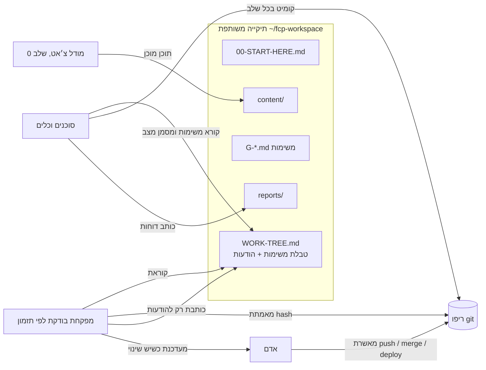

# FCP — File Context Protocol

**ערוץ מבוסס קבצים בסגנון MCP לסוכנים בלי API**

(A file-based MCP-style channel for agents without an API)

חלק מהסוכנים והכלים הטובים ביותר רצים רק כאפליקציה שולחנית. אי אפשר להפעיל אותם משרת, אי אפשר לכתוב להם סקריפט, ואי אפשר לבדוק מרחוק מה הם עושים. FCP פותר את זה בכלי הכי פשוט שיש: תיקייה משותפת של קובצי Markdown במחשב שלך. כל סוכן שיודע לקרוא ולכתוב קבצים לוקח ממנה משימות וכותב אליה את ההתקדמות. עוזרת מפקחת (בוט בענן, סקריפט מתוזמן, או את) קוראת את אותם קבצים, מאמתת את העבודה מול ההיסטוריה האמיתית, ומשאירה הנחיות בתיבת הודעות.

הערוץ פתוח 24/7. אפשר להשתמש בו במהלך היום כדי להעביר עבודה בין כלים, להריץ כמה סוכנים במקביל על אותו תור, או לפקח בזמן שלך בזמן שאת עסוקה בדברים אחרים. **מצב לילה** (עבודה בלי השגחה במשך הלילה) הוא רק אפשרות אחת.

סטטוס: **טיוטה v0.1**. ראי [SPEC.md](SPEC.md) (באנגלית).

## למה

- **בכל שעה, עם כל כלי.** מעבירים עבודה בין סוכנים וכלים במהלך היום, במקביל או בזה אחר זה, מתור משותף אחד.
- **פיקוח בזמן שלך.** את מציצה מתי שנוח לך, והמפקחת מתריעה רק כשמשהו משתנה.
- **בלי אינטגרציה.** אם הסוכן יודע לקרוא ולכתוב קבצים, הוא מדבר FCP.
- **התקדמות אמיתית.** משימה "גמורה" רק עם הוכחה: hash של קומיט אמיתי, או (בלי git) קובץ התוצר. המפקחת בודקת שהוא קיים.
- **שורד הפסקות.** קומיט אחרי כל שלב וטבלת משימות על הדיסק, כך שנגמרת מכסה או קריסה לא מוחקות הרבה.

## התחלה מהירה (3 צעדים)

1. העתיקי את [`testkit/fcp-test/`](testkit/fcp-test/) אל `~/fcp-test`.
2. פתחי בתיקייה הזו כל סוכן שיודע לעבוד עם קבצים, והדביקי בו את [`testkit/PROMPT.txt`](testkit/PROMPT.txt).
3. הסתכלי איך `WORK-TREE.md` משתנה: המשימות עוברות מ-`[ ]` ל-`[~]` ול-`[x]`, ודוחות מופיעים ב-`reports/`.

מוכנה לעבודה אמיתית? העתיקי את [`templates/`](templates/), כתבי משימות, והשתמשי ב-[`prompts/`](prompts/): [`working-agent.md`](prompts/working-agent.md) לכל סוכן ו-[`supervisor-routine.md`](prompts/supervisor-routine.md) למפקחת.

דוגמאות בדיוניות: [`examples/creator-week/`](examples/creator-week/) (העברת עבודה בין כלים במהלך היום) ו-[`examples/overnight-run/`](examples/overnight-run/) (מצב לילה).

### מצב לילה (אופציונלי)
לעבודה בלי השגחה כשאת לא ליד המחשב או ישנה:
- השאירי את המחשב ער. ב-macOS: `nohup caffeinate -imsu -t 36000 &` (10 שעות), ומחובר לחשמל.
- אם לסוכן יש מכסת שימוש ומתזמן מובנה, פתחי סשן סוכן **נפרד** והדביקי בו את [`prompts/night-agent-schedule.md`](prompts/night-agent-schedule.md), כדי שהעבודה תימשך כשהמכסה מתחדשת.
- הוסיפי למפקחת סיכום בוקר.

## איך זה עובד

הלולאה של הסוכן: קורא מחדש את `WORK-TREE.md` מהדיסק ← לוקח את המשימה הראשונה במצב `[ ]` שהתלויות שלה `[x]` ← מסמן `[~]` ← עובד עם קומיט אחרי כל שלב ← כותב `reports/<ID>-REPORT.md` ← מסמן `[x] done <ref>` (hash של קומיט, או קובץ התוצר בלי git) או `[!] blocked: <סיבה>` ← וחוזר. כשאין יותר משימות, כותב `reports/DONE.md` ועוצר.

## FCP מול MCP, במילים פשוטות

| | MCP | FCP |
|---|---|---|
| תקשורת | חיבור חי (stdio / HTTP) | קבצים בתיקייה משותפת |
| דרישה | לקוח שתומך ב-MCP | סוכן שיודע לקרוא ולכתוב קבצים |
| מהירות | מיידי | איטי: דקות בין בדיקות |
| מתאים ל | לתת למודל כלים ומידע | למסור תור עבודה שלם לסוכן שאי אפשר להפעיל מרחוק |
| כיוון | המודל קורא לשרת | שני סוכנים משאירים פתקים זה לזה |

FCP לא מחליף את MCP. הוא ממלא את הפער ש-MCP לא מכסה: סוכנים שנעולים בתוך אפליקציה שולחנית. שאלות נוספות, כולל במה FCP שונה מגשרים דרך תוסף לדפדפן: [FAQ.md](FAQ.md) (באנגלית).

## מעקב מהטלפון (Remote Control של Antigravity)

ב-Antigravity יש Remote Control מובנה, שמאפשר לצפות בסוכנים המקומיים שלכם ולהפעיל אותם ממכשיר אחר.

**הפעלה:** ב-Antigravity נכנסים ל-Settings → Application → Remote Control ומפעילים את **"Enable Remote Control"**. אחר כך סורקים את קוד ה-QR, או מעתיקים את הקישור ופותחים אותו בדפדפן בטלפון. אפשר לתת למכשיר שם (Device Name), ויותר ממכשיר אחד יכול להתחבר.

**כדי שזה ימשיך לעבוד:** המחשב ו-Antigravity צריכים להישאר דולקים ופתוחים. טיפ: באותן הגדרות Application, האפשרות **"Prevent Sleep"** משאירה את המחשב ער כל עוד האפליקציה פועלת.

**איך זה משתלב עם FCP:** ‏Remote Control הוא מסך מרוחק לכלי אחד, ולכן הוא משתמש באותם טוקנים ובאותה מכסה. FCP הוא מה שמאפשר לעבודה לעבור לכלי אחר כשנגמרים הטוקנים, דרך התיקייה המשותפת והכללים הכתובים. ביחד, FCP שומר על העבודה רצה בין הסוכנים, ו-Remote Control מאפשר לכם להציץ ולאשר מהטלפון. האישורים עדיין כפופים לכללי האישור של FCP.

## תאימות

כל כלי שיודע לקרוא ולכתוב קבצים יכול לדבר FCP. ברשימה ב-[COMPATIBILITY.md](COMPATIBILITY.md) (באנגלית) יש סוכני קוד שולחניים, אפליקציות צ׳אט עם גישה לקבצים, כלי אוטומציה, תיקיות מסונכרנות וסקריפטים.

נבדקו בפועל רק שניים: Antigravity כסוכן העובד, ועוזרת מפקחת בענן. ב-Cursor ראינו שההתעוררות המתוזמנת עובדת, אבל ריצה מלאה עוד לא נבדקה. Claude ו-Codex עוד לא נבדקו. השתמשת ב-FCP עם כלי אחר? מוזמנת להוסיף אותו ב-PR.

## כללים מרכזיים

- אין push, merge, deploy, שינוי סביבה או מיגרציה בלי אישור מפורש של אדם.
- משימה גמורה רק עם hash אמיתי של קומיט (או, בלי git, קובץ התוצר), והמפקחת מאמתת אותו.
- המפקחת כותבת רק בסעיף `## Messages from supervisor`.
- אף פעם לא שמים סודות בתיקייה. ראי [SECURITY.md](SECURITY.md) (באנגלית).
- מצב לילה: אם לסוכן יש מכסה ומתזמן, משימת ההתעוררות שייכת ל**סשן סוכן נפרד**. סשן שמתבקש גם להמשיך לעבוד וגם להתעורר אחר כך נוטה לעצור ולחכות לתזכורת.

## ליוצרות: אגדה והכלים האחרים שלך, זה לצד זה

יוצרות כמעט אף פעם לא עובדות עם כלי אחד. פרויקט אחד יכול לעבור דרך אפליקציית צ׳אט שולחנית (Claude, ChatGPT), סוכן קוד (Cursor או סוכן שולחני אחר), ייצואים מ-Canva ותיקייה שמסונכרנת ל-Drive. FCP נותן לכולם תור פרויקט משותף אחד: כל כלי שיודע לקרוא ולכתוב קבצים יכול לקחת משימה מ-`WORK-TREE.md`, להניח את התוצר בתיקייה ולהעביר את השלב הבא לכלי אחר.

בתמונה הזו אגדה היא הבית: היא מפקחת על התור, בודקת את העבודה ושומרת את תיעוד הפרויקט. FCP עצמו פתוח ועובד עם כל מפקחת. כך הפרוטוקול מתוכנן לשמש, וזו לא יכולת שכבר קיימת באגדה.

דוגמה בדיונית קטנה: [`examples/creator-week/`](examples/creator-week/).

## נבנה על ידי הצוות של אגדה

FCP נולד תוך כדי בניית [אגדה](https://gabios.ai) ב-[GabiOS](https://gabios.ai), שם אנחנו משתמשות בו כדי למסור עבודה לסוכן קוד שולחני, ביום ובלילה, בפיקוח של עוזרת מפקחת.

## רישיון

MIT, ראי [LICENSE](LICENSE). שינויים: [CHANGELOG.md](CHANGELOG.md). תרומות יתקבלו בשמחה, ראי [CONTRIBUTING.md](CONTRIBUTING.md). English: [README.md](README.md).
