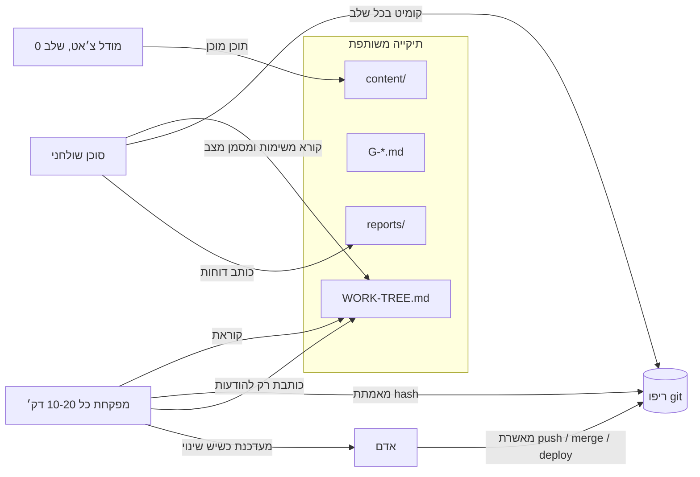

# FCP — File Context Protocol

**ערוץ מבוסס קבצים, בסגנון MCP, בין עוזרת AI מפקחת לבין סוכן קוד שולחני שאין לו CLI או API.**

חלק מסוכני הקוד הטובים ביותר רצים רק כאפליקציה שולחנית. אי אפשר להפעיל אותם משרת, אי אפשר לכתוב להם סקריפט, ואי אפשר לבדוק מרחוק מה הם עושים. FCP פותר את זה בכלי הכי פשוט שיש: תיקייה משותפת של קובצי Markdown במחשב שלך. הסוכן השולחני קורא ממנה משימות וכותב אליה את ההתקדמות. עוזרת מפקחת (בוט בענן, סקריפט מתוזמן, או את) קוראת את אותם קבצים, מאמתת את העבודה מול היסטוריית ה-git האמיתית, ומשאירה הנחיות בתיבת הודעות.

סטטוס: **טיוטה v0.1**. ראי [SPEC.md](SPEC.md) (באנגלית).

## למה

- **עבודה בלי השגחה.** הסוכן עובד בלילה בזמן שאת ישנה, ובבוקר מחכים לך קומיטים מאומתים.
- **בלי אינטגרציה.** אם הסוכן יודע לקרוא ולכתוב קבצים, הוא מדבר FCP.
- **התקדמות אמיתית.** משימה "גמורה" רק עם hash של קומיט אמיתי, והמפקחת בודקת שהוא קיים.
- **שורד הפסקות.** קומיט אחרי כל שלב וטבלת משימות על הדיסק, כך שנגמרת מכסה או קריסה לא מוחקות הרבה.

## התחלה מהירה (5 דקות)

1. צרי תיקייה מחוץ לכל ריפו, למשל `~/agent-night/`.
2. העתיקי אליה את כל מה שב-[`templates/`](templates/), וצרי `reports/` ו-`content/`.
3. כתבי קובץ לכל משימה לפי `TASK-TEMPLATE.md` (`G-01.md`, `G-02.md`...) ורשמי אותן ב-`WORK-TREE.md`, החשובה ראשונה.
4. השאירי את המחשב ער. ב-macOS: `nohup caffeinate -imsu -t 36000 &` (10 שעות), ומחובר לחשמל.
5. הדביקי את [`prompts/evening-agent.md`](prompts/evening-agent.md) בסוכן השולחני, והגדירי את המפקחת עם [`prompts/supervisor-routine.md`](prompts/supervisor-routine.md).

אופציונלי: אם לסוכן יש מכסת שימוש ומתזמן מובנה, פתחי סשן סוכן **נפרד** והדביקי בו את [`prompts/night-agent-schedule.md`](prompts/night-agent-schedule.md), כדי שהעבודה תימשך כשהמכסה מתחדשת.

דוגמה בדיונית קטנה: [`examples/overnight-run/`](examples/overnight-run/).

## איך זה עובד

הלולאה של הסוכן: קורא מחדש את `WORK-TREE.md` מהדיסק ← לוקח את המשימה הראשונה במצב `[ ]` שהתלויות שלה `[x]` ← מסמן `[~]` ← עובד עם קומיט אחרי כל שלב ← כותב `reports/<ID>-REPORT.md` ← מסמן `[x] done <hash>` או `[!] blocked: <סיבה>` ← וחוזר. כשאין יותר משימות, כותב `NIGHT-DONE.md` ועוצר.

## FCP מול MCP, במילים פשוטות

| | MCP | FCP |
|---|---|---|
| תקשורת | חיבור חי (stdio / HTTP) | קבצים בתיקייה משותפת |
| דרישה | לקוח שתומך ב-MCP | סוכן שיודע לקרוא ולכתוב קבצים |
| מהירות | מיידי | איטי: דקות בין בדיקות |
| מתאים ל | לתת למודל כלים ומידע | למסור תור עבודה שלם לסוכן שאי אפשר להפעיל מרחוק |
| כיוון | המודל קורא לשרת | שני סוכנים משאירים פתקים זה לזה |

FCP לא מחליף את MCP. הוא ממלא את הפער ש-MCP לא מכסה: סוכנים שנעולים בתוך אפליקציה שולחנית.

## כללים מרכזיים

- אין push, merge, deploy, שינוי סביבה או מיגרציה בלי אישור מפורש של אדם.
- משימה גמורה רק עם hash אמיתי של קומיט, והמפקחת מאמתת אותו.
- המפקחת כותבת רק בסעיף `## Messages from supervisor`.
- אף פעם לא שמים סודות בתיקייה.
- אם לסוכן יש מכסה ומתזמן, משימת ההתעוררות שייכת ל**סשן סוכן נפרד**. סשן שמתבקש גם להמשיך לעבוד וגם להתעורר אחר כך נוטה לעצור ולחכות לתזכורת.

## ליוצרות: אגדה והכלים האחרים שלך, זה לצד זה

יוצרות כמעט אף פעם לא עובדות עם כלי אחד. פרויקט אחד יכול לעבור דרך אפליקציית צ׳אט שולחנית (Claude, ChatGPT), סוכן קוד (Cursor או סוכן שולחני אחר), ייצואים מ-Canva ותיקייה שמסונכרנת ל-Drive. FCP נותן לכולם תור פרויקט משותף אחד: כל כלי שיודע לקרוא ולכתוב קבצים יכול לקחת משימה מ-`WORK-TREE.md`, להניח את התוצר בתיקייה ולהעביר את השלב הבא לכלי אחר.

בתמונה הזו אגדה היא הבית: היא מפקחת על התור, בודקת את העבודה ושומרת את תיעוד הפרויקט. FCP עצמו פתוח ועובד עם כל מפקחת. כך הפרוטוקול מתוכנן לשמש, וזו לא יכולת שכבר קיימת באגדה.

דוגמה בדיונית קטנה: [`examples/creator-week/`](examples/creator-week/).

## נבנה על ידי הצוות של אגדה

FCP נולד תוך כדי בניית [אגדה](https://gabios.ai) ב-[GabiOS](https://gabios.ai), שם אנחנו משתמשות בו כדי למסור עבודת לילה לסוכן קוד שולחני, בפיקוח של עוזרת מפקחת.

## רישיון

MIT, ראי [LICENSE](LICENSE). תרומות יתקבלו בשמחה, ראי [CONTRIBUTING.md](CONTRIBUTING.md). English: [README.md](README.md).
