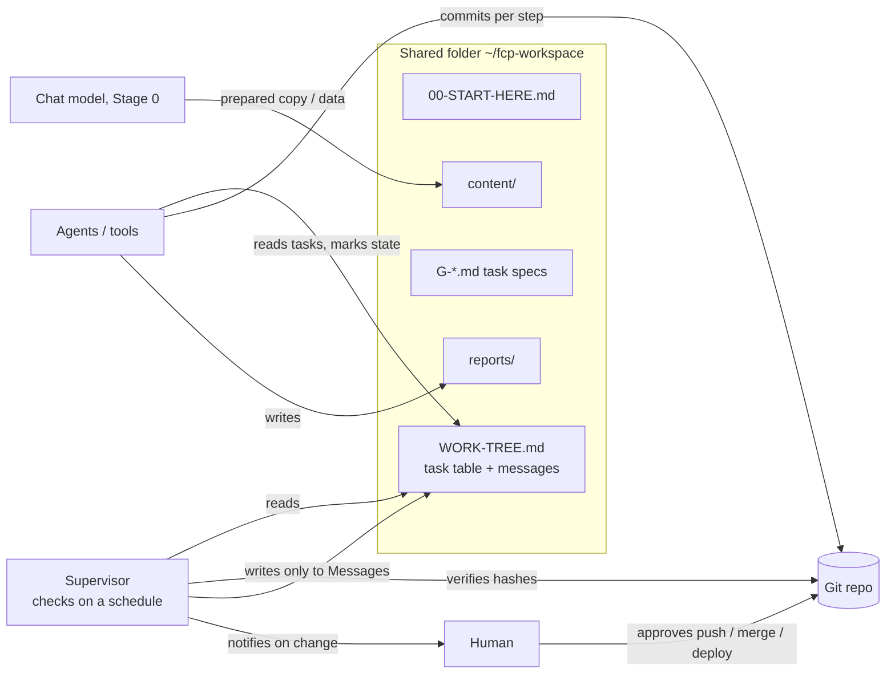

# FCP — File Context Protocol

**A file-based MCP-style channel for agents without an API**

Some of the best AI agents and tools run only as desktop apps. You can't call them from a server, you can't script them, and you can't check on them remotely. FCP connects them with the most boring tool there is: a shared folder of Markdown files. Any agent that can read and write files picks up tasks from it and writes progress back. A supervising assistant (a cloud bot, a scheduled script, or you) reads the same files, verifies the work against real history, and leaves guidance in a message box.

The channel is open 24/7. Use it during the day to hand work between tools, to run several agents in parallel on one queue, or to supervise asynchronously while you do something else. **Night mode** (unattended overnight runs) is one optional way to use it.

Status: **v0.1 draft**. See [SPEC.md](SPEC.md).

## Why

- **Any time, any tool.** Hand work between agents and tools during the day, in parallel or one after another, from one shared queue.
- **Async supervision.** Check in when it suits you; the supervisor only flags changes.
- **No integration needed.** If the agent can read and write files, it speaks FCP.
- **Honest progress.** A task is "done" only with proof: a real commit hash, or (without git) the output file. The supervisor checks it exists.
- **Survives interruptions.** One commit per step plus a task table on disk means quota cut-offs or crashes lose little.

## Quick start (3 steps)

1. Copy [`testkit/fcp-test/`](testkit/fcp-test/) to `~/fcp-test`.
2. Open any file-capable agent in that folder and paste [`testkit/PROMPT.txt`](testkit/PROMPT.txt).
3. Watch `WORK-TREE.md` change: tasks go `[ ]` → `[~]` → `[x]`, and reports appear in `reports/`.

Ready for real work? Copy [`templates/`](templates/), write tasks, and use [`prompts/`](prompts/): [`working-agent.md`](prompts/working-agent.md) for each agent and [`supervisor-routine.md`](prompts/supervisor-routine.md) for your supervisor.

Examples: [`examples/creator-week/`](examples/creator-week/) (daytime handoffs between tools) and [`examples/overnight-run/`](examples/overnight-run/) (Night mode). Both are fictional.

### Night mode (optional)
For unattended runs while you're away or asleep:
- Keep the machine awake. On macOS: `nohup caffeinate -imsu -t 36000 &` (10 hours), plugged in.
- If the agent has a usage quota and a built-in scheduler, open a **separate** agent session and paste [`prompts/night-agent-schedule.md`](prompts/night-agent-schedule.md) so work resumes after the quota renews.
- Add a morning summary to your supervisor.

## How it works

The agent's loop: re-read `WORK-TREE.md` from disk → take the first `[ ]` task whose dependencies are `[x]` → mark it `[~]` → work with a commit per step → write `reports/<ID>-REPORT.md` → mark `[x] done <ref>` (commit hash, or output file without git) or `[!] blocked: <reason>` → repeat. When nothing is left, write `reports/DONE.md` and stop.

## FCP vs. MCP, in plain words

| | MCP (Model Context Protocol) | FCP (File Context Protocol) |
|---|---|---|
| Transport | A live connection (stdio / HTTP) | Files in a shared folder |
| Needs | A client that supports MCP | An agent that can read and write files |
| Speed | Instant calls | Slow: minutes between checks |
| Best for | Giving a model tools and data | Handing a whole work queue to an agent you can't drive remotely |
| Direction | Model calls a server | Two agents leave notes for each other |

FCP isn't a replacement for MCP. It's for the gap MCP doesn't cover: agents locked inside a desktop app. More questions, including how FCP differs from browser-extension bridges: [FAQ.md](FAQ.md).

## Monitor from your phone (Antigravity Remote Control)

Antigravity has a built-in Remote Control that lets you watch and drive your local Antigravity agents from another device.

**Turn it on:** Antigravity → Settings → Application → Remote Control → enable **"Enable Remote Control"**. Then scan the QR code, or copy the link and open it in your phone's browser. You can give the device a name (Device Name), and more than one device can connect.

**Keep it running:** the computer and Antigravity must stay on and open. Tip: in the same Application settings, **"Prevent Sleep"** keeps the computer awake while the app runs.

**How it fits FCP:** Remote Control is a remote screen for one tool, so it uses the same tokens and quota. FCP lets the work move to another tool when one runs out of tokens, through the shared folder and its written rules. Together, FCP keeps the work going across agents, and Remote Control lets you check in and approve from your phone. Approvals still follow FCP's approval rules.

## Run the agent headless (optional)

If your agent has a CLI print mode, the supervisor can launch it on a schedule with strict allow/deny permissions, so no one has to paste the next prompt. See [docs/headless-agent-runner.md](docs/headless-agent-runner.md) and [`examples/agy-runner/`](examples/agy-runner/).

## Compatibility

Any tool that can read and write files can speak FCP. See [COMPATIBILITY.md](COMPATIBILITY.md) for the list, with what we have tested and what should work.

So far only two are tested: Google Antigravity as the working agent and a cloud supervising assistant. In Cursor a scheduled wake-up was seen working, but a full run is untested. Claude and Codex are untested. Used FCP with another tool? Add it via PR.

## Key rules

- No push, merge, deploy, environment change or migration without explicit human approval.
- Completion is claimed only with a real commit hash (or, without git, the output file), and the supervisor verifies it.
- The supervisor writes only in the `## Messages from supervisor` section.
- Never put secrets in the folder. See [SECURITY.md](SECURITY.md).
- Night mode: if the agent has a quota and a scheduler, the wake-up job belongs to a **separate agent session**. A session told to both keep working and wake later tends to park itself waiting for the reminder.

## For creators: Agada and your other tools, side by side

Creators rarely use one tool. A single project might touch a desktop chat app (Claude, ChatGPT), a coding agent (Cursor or another desktop agent), Canva exports, and a Drive-synced folder. FCP gives them one shared project queue: any tool that can read and write files can pick up a task from `WORK-TREE.md`, put its output in the folder, and hand the next step to another tool.

In this picture, Agada is the home base: it supervises the queue, checks the work, and keeps the project record. FCP itself is open and works with any supervisor. This describes how the protocol is designed to be used, not a shipped Agada feature.

See [`examples/creator-week/`](examples/creator-week/) for a small fictional example.

## Built by the team behind Agada

FCP came out of building [Agada](https://gabios.ai) at [GabiOS](https://gabios.ai), where we use it to hand work to a desktop coding agent, day and night, under the watch of a supervising assistant.

## License

MIT, see [LICENSE](LICENSE). Changes: [CHANGELOG.md](CHANGELOG.md). Contributions welcome, see [CONTRIBUTING.md](CONTRIBUTING.md). עברית: [README.he.md](README.he.md).
