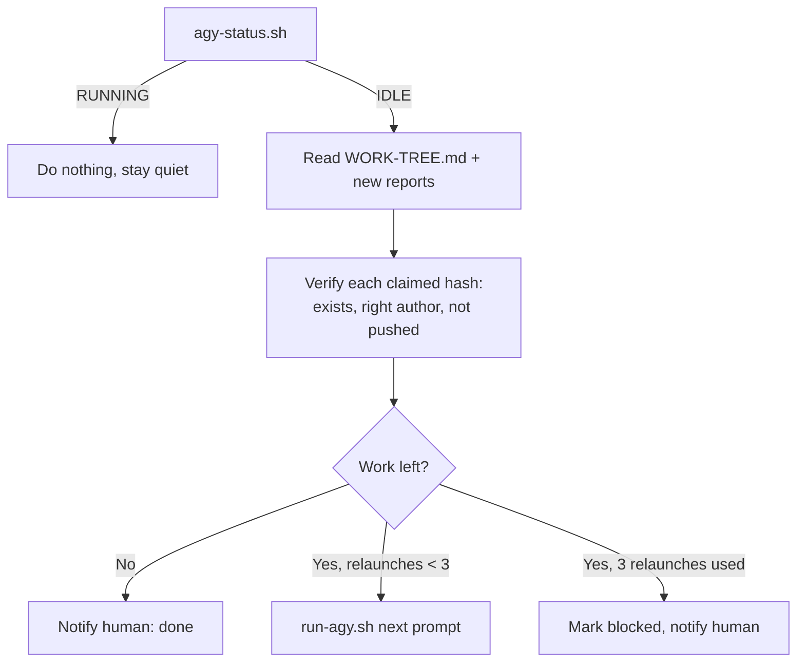

# Headless agent runner (Antigravity CLI)

Some desktop agents also ship a command-line tool. When they do, the supervisor doesn't need a human to paste the next prompt: it can launch the agent itself, on a schedule, under tight permissions. This page shows the pattern with the Antigravity CLI (`agy`). The same idea works for any agent with a non-interactive "print" mode.

FCP stays the same: tasks in `WORK-TREE.md`, reports in `reports/`, proof by commit hash. Only the "who presses start" step is automated.

## 1. Install

```bash
curl -fsSL https://antigravity.google/cli/install.sh | bash   # installs to ~/.local/bin/agy
agy --version
```

The CLI shares sign-in with the Antigravity desktop app. If the app is signed in, the CLI is too. No API key is needed or stored in the FCP folder.

## 2. Headless invocation

```bash
agy -p "$(cat prompts/next-task.md)" \
    --model gemini-4-argon-medium \
    --output-format json \
    --print-timeout 120m \
    --add-dir ~/fcp-workspace
```

- `-p` runs one prompt without a window and exits.
- `--output-format json` gives the supervisor a machine-readable result, including `denied_actions`.
- `--add-dir` lets the agent read and write the FCP folder in addition to the repo it runs in.
- An "auto" mode may not be available on every account. Don't rely on it: grant exactly what the agent needs with permission rules (next section). Anything not allowed is soft-denied and shows up in `denied_actions`.

## 3. Permissions: allow the work, deny the irreversible

Rules live in `~/.gemini/antigravity-cli/settings.json` under `permissions.allow` and `permissions.deny`, in the form `command(regex:...)`. Full example: [`examples/agy-runner/settings.example.json`](../examples/agy-runner/settings.example.json).

| Allow | Deny |
|---|---|
| git read / branch / add / commit | `git push`, `merge`, `rebase`, `remote`, `config`, `reset --hard` |
| `npx vitest`, `npx tsc` | `vercel` (deploys) |
| `npm test`, `typecheck`, `lint` | `supabase db push` (migrations) |
| `node`, basic read commands | `rm -rf` |

**Test it before trusting it:** run one headless prompt that executes an allowed command (e.g. `git status`) and one that tries `git push --dry-run`. The first should run; the second must appear in `denied_actions`.

## 4. Launcher and status scripts

In [`examples/agy-runner/`](../examples/agy-runner/):

- **`run-agy.sh <prompt-file> [model]`**
  - One run at a time (lock file `runs/agy.lock`).
  - Refuses `claude-opus-*` models (see Quota below).
  - Default model `gemini-4-argon-medium`.
  - Works in `$AGY_WORKDIR` (default: current dir), adds `$FCP_DIR` with `--add-dir`.
  - Runs with `nohup` in the background and writes `runs/<timestamp>.json` + `.err`.
- **`agy-status.sh`** — prints `RUNNING` or `IDLE`, the last run, its `denied_actions` count, and the tail of the result.

```bash
export FCP_DIR=~/fcp-workspace AGY_WORKDIR=~/code/my-repo
./run-agy.sh "$FCP_DIR/prompts/D-2.md"
./agy-status.sh
```

## 5. The supervisor's relaunch loop

Your supervisor (cloud bot, cron job, or you) runs every 15 minutes:



Safety rules for the loop:

- **Never** push, merge, deploy, change env vars or run migrations from the loop. Humans approve those.
- Max **3 relaunches per task**. After that, a human looks.
- "Done" counts only with a verified commit hash (`git cat-file -e <hash>`, author check, `git branch -r --contains <hash>` empty).
- Any `denied_actions` entry is reported to the human, never retried with a workaround.
- An approval written by a model is not a human approval.

## 6. Quota guidance

- Big models on big tasks can drain a usage quota in minutes. Default to a mid-tier model and keep tasks small: one task spec, one branch, a few commits.
- Run mechanical scans (grep, lint, typecheck) as scripts, and give the agent only what they flag.
- The launcher blocks the most expensive model family by name. Edit the `case` line to match your plan.
- One run at a time keeps usage predictable and logs readable.
